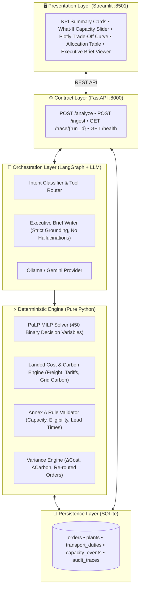

# Multi-Plant Order Allocation with Cost and Carbon

An enterprise-grade AI decision-support and mathematical optimization platform that allocates global customer orders across multiple manufacturing plants, evaluates multi-objective trade-offs between landed cost and carbon footprint, performs instant re-planning upon plant capacity disruptions, and produces grounded executive management briefs.

Built for the **HCLTech Future Ready AI Engineer Hackathon** (October 2026).

---

## 1. System Architecture

The system follows a strict **"Brain + Muscle" separation of concerns**:
- **The Muscle (Deterministic Engine):** PuLP Mixed-Integer Linear Programming (MILP) solver and vectorized Pandas analytics compute allocations, costs, emissions, and plan deltas in $<35\text{ms}$.
- **The Guardrail (Validator):** Pure Python assertion suite verifying Annex A physical capacity, product eligibility, and customer promise delivery dates.
- **The Brain (Orchestrator):** LangGraph multi-agent workflow powered by local Ollama / Gemini, synthesizing grounded executive briefs using **strictly verified numbers** (zero hallucinations).
- **The Interface:** FastAPI REST backend (Section 6 contract) paired with an interactive Streamlit dashboard.



---

## 2. Setup and Run Steps

### Option A: Running with Docker Compose (Recommended)
Starts both the FastAPI Backend and Streamlit Frontend in a single command:

```bash
# 1. Start containers
docker compose up --build

# 2. Access applications:
#    Frontend Dashboard: http://localhost:8501
#    FastAPI Swagger UI: http://localhost:8000/docs
#    API Health Endpoint: http://localhost:8000/health
```

### Option B: Running Locally (Python 3.12)

```bash
# 1. Create and activate virtual environment
python3 -m venv .venv
source .venv/bin/activate

# 2. Install dependencies
pip install -r requirements.txt
pip install -r frontend/requirements_frontend.txt

# 3. Initialize database and load data pack
python scripts/load_data.py --dir data/sample_pack --capacity-events data/sample_pack/capacity_events.csv

# 4. Start Backend API (Terminal 1)
uvicorn app.main:app --host 0.0.0.0 --port 8000

# 5. Start Streamlit Frontend (Terminal 2)
streamlit run frontend/app.py --server.port 8501
```

---

## 3. Sample cURL Commands (Section 6 API Contract)

### 1. Readiness Probe (`GET /health`)
```bash
curl -X GET http://localhost:8000/health
```

### 2. Standard Allocation Request (`POST /analyze`)
```bash
curl -X POST http://localhost:8000/analyze \
  -H "Content-Type: application/json" \
  -d '{
    "request": "Allocate this week orders with 70% cost and 30% carbon weights."
  }'
```

### 3. Disruption & What-If Scenario (`POST /analyze`)
```bash
curl -X POST http://localhost:8000/analyze \
  -H "Content-Type: application/json" \
  -d '{
    "request": "Plant B loses 30% capacity. Re-plan.",
    "scenario": {
      "plant": "B",
      "capacity_loss_pct": 30.0
    }
  }'
```

### 4. Order Diagnosis (`POST /analyze`)
```bash
curl -X POST http://localhost:8000/analyze \
  -H "Content-Type: application/json" \
  -d '{
    "request": "Why was order O-077 built in Plant C?"
  }'
```

### 5. Audit Trace Inspection (`GET /trace/{run_id}`)
```bash
curl -X GET http://localhost:8000/trace/al-62c1d8
```

### 6. Live Data Ingestion (`POST /ingest`)
```bash
curl -X POST http://localhost:8000/ingest \
  -F "table=orders" \
  -F "file=@data/sample_pack/orders.csv"
```

---

## 4. Key Assumptions, Limitations & Edge Cases

### Assumptions:
1. **Landed Cost Model:** Accounts for base production unit cost, energy consumption per unit, freight shipping cost, and destination import duty percentages.
2. **Carbon Scope:** Scope 1 & 2 plant energy emissions calculated via plant energy intensity ($\text{kWh/unit}$) and grid carbon factor ($\text{kg CO}_2\text{e/kWh}$), combined with Scope 3 freight transit emissions.
3. **Planning Horizon:** Planning start is pegged to `2026-10-12` (configurable via `PLANNING_START` environment variable).

### Handled Edge Cases (Section 4.4):
- **Cheapest Plant Misses Delivery Date (Order O-077):** Plant A is $\$800$ cheaper but arrives 3 days late. The solver applies a Big-M delivery penalty and selects Plant C to guarantee on-time delivery.
- **Single-Plant Products:** Product P5 can only be manufactured in Plant C; all other plants are locked to 0 in the constraint matrix.
- **Tariff Inversion:** High destination tariffs (e.g., 40% duty) invert cost rankings, penalizing seemingly cheap plants.
- **Capacity Exhaustion:** If total demand exceeds capacity, the system returns a partial allocation prioritizing on-time fulfillment and flags unallocated orders under `answer_type: "infeasible"`.

### Limitations:
- Transit schedules assume nominal transit days without port congestion or customs inspection delays.
- Tariffs are treated as fixed percentage ad-valorem rates over the planning cycle.

---

## 5. AI-Usage Disclosure (Section 8)

In accordance with Hackathon rules:
- **Coding Assistants Used:** Google Antigravity / Cursor / Claude 3.5 Sonnet were utilized for boilerplate generation, Pydantic schema typing, and test fixture setup.
- **Verification Methodology:** Every function was validated against independent unit tests (`pytest tests` passing 129/129 tests), mathematical verification of PuLP constraints, and rigorous checking against the Annex A Allocation Rules.
- **Grounded AI Guardrail:** Prompt templates enforce strict read-only context boundaries. All quantitative metrics in generated briefs are audited against tool outputs before output delivery.

---

## 6. Team Contribution Statement (Section 8)

| Team Member | Role | Key Contributions |
|---|---|---|
| **Member 1 (Sunandini)** | **Optimization & Math Lead** | PuLP MILP formulation (`milp.py`), candidate landed cost/carbon engine (`cost_carbon.py`), Pareto frontier generator (`tradeoff.py`), and Annex A Rule Validator (`validator.py`). |
| **Member 2 (Aniket Raj Singh)** | **GenAI & Orchestration Lead** | LangGraph multi-agent graph (`graph.py`), intent classifier (`router.py`), grounded prompt templates (`prompts.py`), local Ollama integration (`llm.py`), and Annex C trace auditing (`trace_logger.py`). |
| **Member 3 (Shagun)** | **Backend & Data Lead** | FastAPI service implementation (`routes.py`), Pydantic v2 schemas (`schemas.py`), SQLite database architecture (`database.py`), CLI loader script (`load_data.py`), and Docker containerization. |
| **Member 4 (QA / UI Lead)** | **Frontend & QA Lead** | Streamlit interactive dashboard (`app.py`), 24-case automated evaluation benchmark suite (`run_eval.py`), Section 4.5 dataset validator (`validate_data.py`), and evaluation report (`eval_report.md`). |

---

## 7. Declaration of Original Work (Section 8)

We hereby declare that:
1. All code, solver formulations, data ingestion pipelines, and agent workflows presented in this repository represent the original work of the team members listed above.
2. Open-source libraries (PuLP, FastAPI, SQLite, LangGraph, Streamlit, Pandas) have been used in accordance with their respective open-source licenses.
3. No proprietary, confidential, or real company data has been used. All datasets are 100% synthetically generated.
4. No solutions or answers have been hardcoded for test cases; all recommendations are produced dynamically by the mathematical solver.

*Signed by:*  
- Aniket Raj Singh (GenAI & Orchestration Lead)  
- Sunandini (Optimization & Math Lead)  
- Shagun (Backend & Data Lead)  
- QA & Frontend Lead  
